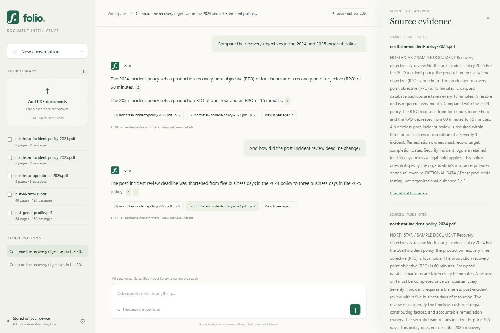

# Folio
### Evidence-first conversations across your PDFs

I built Folio for **Humanli.ai Assignment 3 — Intelligent Multi-Document RAG System**.
My focus is reliable answers backed by PDF evidence, useful follow-up conversations, and a codebase that is easy to run and inspect.
Upload multiple PDFs, ask questions across them, follow page-level citations, and continue with
contextual questions. Conversations survive application restarts. Missing evidence is handled explicitly.

**Stack:** FastAPI · LangGraph · SQLite · local Sentence Transformers · BM25 + rank fusion · cross-encoder reranking · Groq GPT-OSS.



## Quick start

Requires Python 3.11–3.13 (tested with 3.12), internet for initial model downloads and Groq requests,
and a Groq key with access to `openai/gpt-oss-120b`. Free-tier quotas depend on your account.

```bash
python -m venv .venv
# Windows: .venv\Scripts\activate
# macOS/Linux: source .venv/bin/activate
pip install -r requirements-lock.txt
```

Copy `.env.example` to `.env`, set `LLM_API_KEY`, and start:

```bash
uvicorn app.main:app --host 127.0.0.1 --port 8000
```

Open **http://127.0.0.1:8000**. Click **Explore sample workspace**, then ask:

- “Compare the production RTO and RPO between the 2024 and 2025 incident policies.”
- “How did the post-incident review deadline change between those policies?”
- “What is the maternity leave entitlement?”

The first semantic search loads local embedding and reranking models. Later searches reuse them.
No key? The application provides a visibly labeled evidence preview, not a simulated LLM answer.
For constrained machines, set `EMBEDDING_BACKEND=tfidf` and `RERANK_ENABLED=false`.
This fallback is lexical retrieval and is labeled accordingly.

## What I built

- Multiple PDF uploads, duplicate detection, document selection, removal, and page-preserving extraction.
- Local semantic retrieval + corpus-wide BM25, reciprocal rank fusion, and cross-encoder reranking.
- History-aware question rewriting and SQLite-backed conversation persistence.
- Bounded corrective retrieval: evidence grading followed by at most one reformulated document search.
- Compound-question decomposition that searches distinct factual asks separately before synthesizing an answer.
- An explicit LangGraph workflow adapted from my Cyber Ireland project, with tested retry limits.
- Structured per-claim citations, citation-ID validation, and optional grounding reflection.
- Answered, partial, unavailable, and explicitly labeled evidence-preview states.
- An interface with conversation history, source excerpts, PDF page links, and retrieval/timing details.
- Groq by default; configurable OpenAI-compatible providers and Ollama support.
- Optional page-level OCR fallback for scanned PDFs.

I adapted corrective and reflective RAG patterns for this workflow. I have not reproduced
the original Self-RAG trained model or the complete CRAG research method. See [architecture](docs/ARCHITECTURE.md).

## Model configuration

Default embedding: `sentence-transformers/all-MiniLM-L6-v2`.
Default reranker: `cross-encoder/ms-marco-MiniLM-L-6-v2`.
Default hosted generation: `openai/gpt-oss-120b` through Groq's OpenAI-compatible endpoint.

`ADAPTIVE_RETRIEVAL` and `VERIFY_GROUNDING` add model calls. A standalone question usually uses three
calls when both are enabled; follow-ups add a rewrite call. If reflection rejects claims, one shorter
answer revision and one additional check are allowed. Corrective search runs at most once.
Provider rate-limit errors receive bounded retries, then a clear failure without saving a fabricated answer.

For Ollama, set `LLM_PROVIDER=ollama`, `LLM_BASE_URL=http://localhost:11434`, and `LLM_MODEL` to an installed
instruction-following model that supports JSON output. This configuration is supported by the adapter
but must be separately evaluated for the chosen local model.

## Scanned PDFs

Install Tesseract with its English language data and the renderer:

```bash
pip install pypdfium2
```

Set `OCR_ENABLED=true` and, if needed, `TESSERACT_CMD` to the executable path. OCR runs only on pages
without useful embedded text. The Docker image includes Tesseract; enable OCR explicitly.
English OCR is the supported default. I have not validated OCR for arbitrary languages or complex layouts.

## Verification and evaluation

```bash
pytest -q
ruff check app scripts tests
mypy app scripts
python -m scripts.evaluate                         # retrieval only; no paid model calls
python -m scripts.evaluate --live --delay 3         # real configured LLM, 30 cases
python -m scripts.evaluate --live --basic --output evaluation/basic-results.json
```

I use automated tests to check ingestion, page citations, duplicate handling, session isolation, restart persistence,
document filtering, deletion, malformed inputs, model failure, and invalid citations. Tests use a
lexical backend and controlled model doubles; these are integration correctness tests, not model quality scores.

I created **three fictional PDFs and 30 evaluation cases**, including comparisons,
follow-ups, exceptions, unanswerable questions, and an instruction-override attempt. My evaluator compares BM25
with hybrid retrieval on expected PDF page recall at five passages. Live runs record complete answers,
expected-term diagnostics, cited expected-page recall, abstention, errors, and latency.

**Interpretation:** expected-term checks are not semantic answer grading. Page recall is not citation
entailment. A self-check by the same LLM is not independent evidence of correctness. I use this deliberately
small corpus for regression checks; it does not establish generalization to other documents. Results and caveats are
stored alongside each run; model quality on your own reports needs separate review.
Read [the evaluation review](evaluation/REVIEW.md) for measured initial results and analysis of failures.

See [sample provenance](samples/README.md), [architecture and tradeoffs](docs/ARCHITECTURE.md), and the
[reviewer demo](docs/DEMO.md). The original sample text is CC0 and can be regenerated with
`python -m scripts.make_samples` (requires the included ReportLab development dependency).

I describe my approach to typed contracts, dependency injection, structured logging, and error
propagation in [engineering decisions](docs/ENGINEERING.md).

Two unmodified public NIST reports (112 physical PDF pages total) are also included, with source URLs
and checksums. Click **Load NIST technical reports** in the app, or upload them manually. Evaluate them with:

```bash
python -m scripts.evaluate --live --corpus public --cases evaluation/public-cases.json --output evaluation/public-results.json
```

Run evaluations sequentially on a free provider account. Parallel evaluation and interactive chat can
compete for the same token quota. The 30-case corpus uses multiple calls per case and may need longer
delays or a later run if daily limits are reached. A rate-limit failure is recorded as an error, not a pass.

Groq requests are serialized and paced using a configurable local token bucket. Input tokens are
estimated with `o200k_base`, including a framing allowance; this is an approximation of the provider's
accounting, not an exact guarantee. `PROVIDER_TOKENS_PER_MINUTE=8000` matches the free account I used
for testing; set it to your own limit. `MAX_INPUT_TOKENS=5500` bounds input. The limiter coordinates one
process only. Latencies include pacing and retry waits. GPT-OSS 20B is a supported lower-quota-cost
alternative: set `LLM_MODEL=openai/gpt-oss-20b`. Results always identify the model actually used.

## Docker

```bash
docker compose up --build
```

Compose binds only to localhost and persists SQLite, uploads, and model cache in a named volume.
I checked the Compose configuration, but have not verified the image build or container startup.
The deployment recipe still needs a smoke test on the target host.

## Data handling and limits

PDFs, indexes, and conversation records are local. With hosted generation, the question, bounded
recent conversation, and selected evidence excerpts are sent to the configured LLM provider.
Keys remain server-side. The UI renders document/model text as text, never unsanitized HTML.

This is a **single-user workspace**. Session separation does not implement multi-user authorization.
Use `APP_ACCESS_TOKEN` for a shared API gate if needed; per-user ownership and production authentication
are outside this assignment. Keep the default localhost binding. Use one application worker.

Limits: 20 MB/PDF, 250 pages/PDF, 30 documents/workspace, 10 uploads/request, four recent turns of LLM
context. Large corpora and concurrent ingestion require background jobs and a scalable vector index.
Complex tables, figures, and OCR errors can reduce answer quality. Citation numbers identify supplied
passages but cannot independently prove that a model's interpretation is correct.

Removing a PDF removes its searchable chunks and stored file. Earlier conversation records retain their
previous answer excerpts; remove the conversation too if that history should no longer be retained.

## Project layout

```text
app/                 API, ingestion, retrieval, generation, persistence, UI
samples/             Source corpus, generated PDFs, provenance
evaluation/          Authored questions and measured result artifacts
tests/               Automated checks for API behavior, isolation, citations, and retry bounds
scripts/             Sample generator, public-report downloader, evaluator
docs/                Architecture, limitations, reviewer walkthrough
```

I reimplemented and extended patterns from my earlier
[Document_QnA_system](https://github.com/Sajjad01-chaus/Document_QnA_system), with corrected page metadata,
persistent state, explicit citation checks, and reproducible verification.
For corrective retrieval and reflection, I adapted my graph design from
[Cyber-Ireland-Auto-RAG](https://github.com/Sajjad01-chaus/Cyber-Ireland-Auto-RAG/blob/main/graph.py).
For bounded query decomposition, I adapted my design from
[MultiLang_RAG](https://github.com/Sajjad01-chaus/MultiLang_RAG/blob/main/app/query_decomposer.py).
