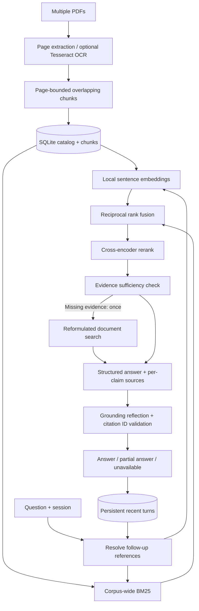

# Architecture and engineering decisions

## Retrieval

The default sentence-transformer creates normalized, local 384-dimensional vectors. Dot product is
cosine similarity. NumPy exact search is deliberate for the assignment's bounded corpus: it avoids an
external database and makes filtering and deletion easy to verify. Embeddings are cached on disk by
model name and corpus chunk IDs. BM25 is computed across the entire corpus, not independently per PDF.
Rank fusion combines incomparable score scales with `1/(60+rank)`. A local cross-encoder reranks the
first 20 fused candidates; only six passages are normally sent to the LLM.

`EMBEDDING_BACKEND=tfidf` is an explicit lightweight lexical fallback, not a semantic embedding model.
The API and UI disclose the backend. Cross-encoder reranking is independently configurable.
Scores are ranking signals; the UI does not present them as correctness probabilities.

## Correction and reflection

Compound questions containing distinct asks are decomposed into at most three focused search queries.
I adapted my `MultiLang_RAG/app/query_decomposer.py` design while avoiding naive splitting
of every `and` (which damages date comparisons). Each subquery contributes up to three passages, then
the merged context is deduplicated and bounded to eight passages. The planner adds one model call only
for detected compound asks. Decomposition and correction together have a hard bound of five searches:
one original, up to three subqueries, and one corrective query.

`app/workflow.py` implements these transitions in LangGraph, adapting my
`Cyber-Ireland-Auto-RAG/graph.py`. It removes report-specific routing and math execution while preserving
the evidence-grade, rewrite/retrieve, generate, and reflect stages. The correction path has a maximum
of two total searches and a direct edge to generation. Tests explicitly verify that bound.

When enabled, one LLM check judges evidence sufficiency. If evidence is insufficient, it can request
**one** alternative document query. Results are merged, deduplicated, bounded to eight passages, and
then used for generation. There is no web fallback: the assignment requires uploaded-document grounding.
A second check removes claims not supported by their cited passages. If any are removed, one shorter
revision is generated and checked again. The revision counter is incremented in an actual graph node,
and tests enforce a maximum of two generation calls. Claims still rejected produce a partial answer
or abstention. Invalid citation numbers fail closed.

These mechanisms are **inspired by corrective and reflective RAG patterns**. They are not reproductions
of the CRAG research pipeline or the original Self-RAG model trained with reflection tokens. The same
LLM performs generation and verification, so correlated mistakes remain possible. I do not equate a
passing verifier with proven factual accuracy. Disable individual stages for cost/latency ablations.

## Conversation memory

SQLite persists sessions and turns. The last four turns (questions bounded to 800 characters, answers
to 1,600 characters each) are supplied to a standalone-question rewrite
and answer generation. Historical answers resolve references but are not considered factual evidence.
All factual support must come from current retrieval. Session locks serialize concurrent turns in a
single server process. This is bounded short-term conversational memory with durable history, not
unlimited long-term semantic memory. There is intentionally no shared answer cache.

## Extraction and OCR

Chunks never cross PDF page boundaries. Text extraction preserves physical page indices. Optional OCR
renders only pages without useful embedded text, then runs Tesseract on that page. OCR uses English by
default and needs the language pack plus `pypdfium2`. OCR errors are explicit; extraction does not claim
success on unreadable PDFs. Complex tables are extracted as text, without table-structure guarantees.

## Storage and scope

Documents use generated storage IDs rather than filenames. SHA-256 suppresses duplicate uploads.
The document catalog and chunks commit together. Deletion removes both PDF and indexed chunks; the
next search invalidates the embedding snapshot. Previous conversation excerpts remain as historical
records. The README/UI disclose this behavior.

This is a **single-user workspace**, not a multi-tenant service. Conversation separation is not user
authorization. An optional shared token gates all API routes, including PDFs, but it does not create
per-user access controls. Localhost binding is the documented default. Run one worker. Horizontal
scaling needs durable job orchestration, bounded lock lifecycle, distributed concurrency control,
per-user ownership, and background ingestion.

## Relationship to previous work

My earlier [Document_QnA_system](https://github.com/Sajjad01-chaus/Document_QnA_system) implements PDF/OCR
ingestion, BM25 + vector rank fusion, cross-encoder reranking, and Groq integration. For this assignment, I
reimplemented those patterns with local persistence, corrected page metadata, explicit failure behavior,
and reproducible evaluation. See `app/ocr.py` for the adapted OCR design. It does not depend on the older
repository or claim that its code already implemented reflective/corrective stages.
